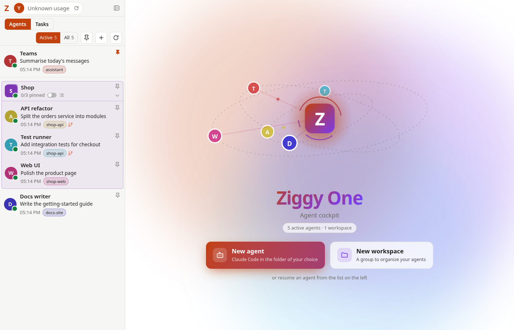
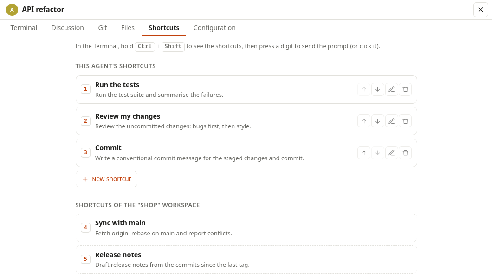
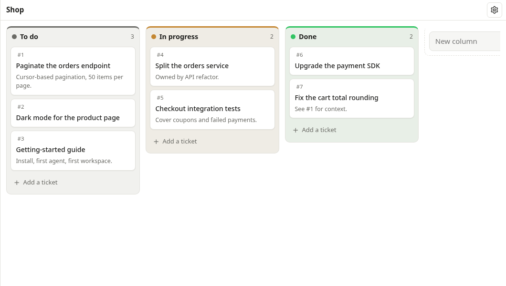

# Ziggy One

**Agentic Collaboration Environment: run many [Claude Code](https://docs.anthropic.com/en/docs/claude-code) agents side by side, and stay in control.**

Each agent is the real, interactive Claude Code running in its own terminal, in the browser. Ziggy One keeps them
organised (workspaces, pins, names, avatars), shows what they are doing (live status, context usage, a readable
view of the conversation), lets them coordinate (shared activity, an agent directory, a Kanban board they can use
through MCP), and tracks your plan usage, all from one page served on `127.0.0.1`.



> **Zero third-party dependencies.** The server is the Python standard library; the front end is vanilla
> HTML/CSS/JS with no npm and no build step. The only vendored code is [xterm.js](https://xtermjs.org/) (MIT), pinned
> and checksummed, with its full TypeScript source in the published source map, plus 42 [Twemoji](https://github.com/jdecked/twemoji) SVGs (CC-BY 4.0) used as avatars.

> The interface is in **English** by default and also available in **French** (Configuration › General).
> More languages are welcome: see [CONTRIBUTING.md](CONTRIBUTING.md). Every module is described in the
> [detailed guide](docs/GUIDE.md).

## Features

- **Real Claude Code terminals.** Every agent runs `claude` in a pseudo-terminal (xterm.js in the page), so every
  command, slash command and permission prompt works exactly as in your own terminal. Closing the browser tab does
  not stop the agent.
- **Many agents at once.** Start, resume, pin, rename, group into **workspaces**, give avatars; the list shows
  who is working, who is idle and who is **waiting for you** (permission or question), with desktop notifications.
- **Discussion view.** A clean, read-only rendering of the session (Markdown answers, folded tool calls,
  sub-agents), with copy/PDF export, a composer that types into the terminal, and a `!!` shell console.
- **Prompt shortcuts.** Ready-made prompts per agent and per workspace. Hold <kbd>Ctrl</kbd>+<kbd>Shift</kbd> in the
  terminal to show them, press <kbd>Ctrl</kbd>+<kbd>Shift</kbd>+<kbd>1</kbd>…<kbd>0</kbd> to send one.
- **Agent roles and directory.** Give an agent a role ("sends and reads Teams messages"). Every session started by
  Ziggy One learns, through a `SessionStart` hook, which agents exist and how to reach them (`SendMessage`).
- **Shared activity.** Agents of the same workspace working in the same repository get a short digest of what the
  others did since their last message (no model call, about 400 tokens at most, can be turned off).
- **Kanban boards.** Boards, columns, tickets with Markdown and attachments, full history, numbered links. Agents
  get a local MCP server (`kanban_*` tools) to read, create, update and move tickets.
- **Files and Git tabs.** Browse, search and edit the agent's folder; stage, commit, branch, pull and push.
- **Usage and context.** Your plan's 5-hour and weekly usage, and each agent's context window fill.
- **Clean restarts.** Restarting the server pauses working agents, waits for them, then reopens every terminal and
  lets them resume.

<p align="center">
  
  
</p>

## Requirements

- **Linux or macOS.** Terminals rely on `pty` and a controlling terminal per agent. Windows is not supported yet:
  there, `ziggy` only says so and exits.
- **Python 3.10+.** Nothing to install: standard library only.
- **[Claude Code](https://docs.anthropic.com/en/docs/claude-code)** installed and logged in (`claude` on your
  `PATH`). Ziggy One uses your existing Claude Code account and never sees your credentials.
- A recent Chromium-based browser or Firefox. Optional: `git` (Git tab), Chrome/Chromium (PDF export), Node.js 22+
  (front-end tests only).

## Quick start

```bash
git clone https://github.com/molory/ziggy-one.git
cd ziggy-one
ln -s "$PWD/ziggy" ~/.local/bin/ziggy   # once: the `ziggy` command, from any folder
```

`~/.local/bin` must be on your `PATH` (it usually is on Linux; on macOS, create it and add it to your shell profile if needed). On
Windows, the repository folder goes on the `PATH` instead, and `ziggy.cmd` runs the same launcher.

Then, in the folder you want your agents to work in:

```bash
ziggy                            # or: ziggy --permission-mode auto, any option below
```

- Ziggy One starts with that folder as the default for new agents and opens in your browser, **already logged in**.
- If it is **already running**, `ziggy` does not start a second one: it just opens the interface (from any folder).
- If the port is taken by another program, `ziggy` says so: choose another one with `--port`.

Then click **New agent**. Stop Ziggy One with <kbd>Ctrl</kbd>+<kbd>C</kbd> in its terminal; agents' terminals are
closed cleanly.

### Logging in without exposing the token

The access token never shows up: not in the terminal, not in the browser's address bar or history, not on a
command line. `ziggy` opens the browser on a **single-use login link** (`/?login=…`), signed with the token, that
expires after 5 minutes and is exchanged for a session cookie. Once used, the link is worthless wherever it was
copied: shell scrollback, `ps`, browser history, a log file.

- **No browser at hand?** Started as `python3 server.py` (no `--open`), or when no browser can be opened, the server
  prints the login link instead. Run `ziggy` again for a fresh one.
- **Bookmark** `http://127.0.0.1:6767/`, never a login link. If the browser lost the cookie (it lasts until the
  browser is closed), run `ziggy` again.
- **Token leaked anyway?** Restart once with `--new-token`: open tabs, ticket links and agent keys are invalidated.
- `/?token=<token>` still logs in, for scripts that already use it; the token is in
  `~/.local/share/ziggy-one/token` (`0600`).

| Option | Meaning |
|---|---|
| `--port 6767` | Port to listen on (always `127.0.0.1`). |
| `--cwd DIR` | Default folder for new agents (default: current directory). |
| `--model MODEL` | Default model of the agents (default: Claude Code's own). |
| `--permission-mode MODE` | Default permission mode: `default`, `acceptEdits`, `plan`, `auto` or `dontAsk`. |
| `--allowed-tools "Bash(git status)" Edit …` | Tools allowed without asking. |
| `--chrome` | Enable Claude in Chrome for the agents. |
| `--open` | Open the interface in the browser with a login link (`ziggy` always passes it). |
| `--new-token` | Generate a new access token (invalidates open tabs, ticket links and agent keys). |

Every agent can override the model, permission mode and Chrome setting in its **Configuration** tab.

## Where data lives

Everything stays on your machine, in `~/.local/share/ziggy-one/` (or `$XDG_DATA_HOME/ziggy-one/`), with `0700`
directories and `0600` files: agents and their settings, workspaces, pins, shortcuts, Kanban boards and their
attachments, the activity journal and the access token. Ziggy One only **reads** Claude Code's own files
(`~/.claude/sessions/`, `~/.claude/projects/`) to list sessions and render discussions.

## Security model

Ziggy One is a single-user tool for your own machine.

- Listens on `127.0.0.1` only and checks the `Host` header (DNS rebinding protection).
- Access requires a random token, exchanged for an `HttpOnly; SameSite=Strict` cookie; every `POST` must carry a
  local `Origin` (CSRF protection).
- The token itself is never printed: logging in goes through single-use login links (HMAC of the token, 5-minute
  expiry, rejected once used), so a link found in a log or a browser history cannot be replayed.
- Strict Content Security Policy: no inline scripts, no CDN, no `innerHTML` with untrusted content.
- Claude Code hooks and the agents' MCP server use their own secrets, stored in `0600` files and never passed on a
  command line.
- Agents act with **your** permissions: review Claude Code's permission prompts as you would in a terminal, and
  choose permission modes carefully.

See [SECURITY.md](SECURITY.md) to report a vulnerability.

## How it works

```
browser (vanilla JS + xterm.js) ── HTTP + Server-Sent Events ── server.py (Python stdlib, 127.0.0.1)
                                                                   │
                                     pty (own session) ────────────┼──> claude  (one per agent)
                                     hooks (ziggy_hook.py) <───────┤      ├─ SessionStart / UserPromptSubmit / Stop …
                                     MCP over HTTP (/mcp)  <───────┘      └─ kanban_* tools
```

- `server.py` serves the page, the JSON API and an SSE stream; `terminal.py` runs `claude` in a pseudo-terminal
  and streams its screen; `ziggy_hook.py` is the Claude Code hook that reports turns and injects context.
- Claude Code's session files are an undocumented format: `transcripts.py` reads them defensively, so a format
  change can at worst make the Discussion view incomplete. The terminal itself never depends on it.

The [detailed guide](docs/GUIDE.md) describes every module and behaviour.

## Development

```bash
python3 -m unittest discover -s tests     # server tests (use a fake `claude`, no quota spent)
node --test tests/*.test.mjs              # front-end logic tests (Node 22+)
```

Contributions are welcome: please read [CONTRIBUTING.md](CONTRIBUTING.md) first, especially the
**no-dependency** rule.

## License

[MIT](LICENSE) © 2026 Marc Olory. Third-party components keep their own licenses, see
[THIRD_PARTY_NOTICES.md](THIRD_PARTY_NOTICES.md).

Ziggy One is an independent project, not affiliated with or endorsed by Anthropic. "Claude" and "Claude Code" are
trademarks of Anthropic.
